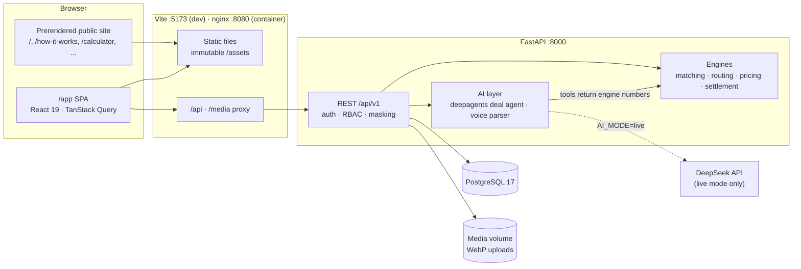

<div align="center">

# MandiMate

### Better deals. Shared logistics. More money for farmers.

A farmer-first agricultural marketplace that pools small harvests into buyer-ready lots,
negotiates with verified buyers, coordinates shared transport and shows every farmer, in plain
numbers and their own language, what they will actually take home.

[Quick start](#quick-start) · [The journey](#the-journey-eight-steps-one-workflow) · [Architecture](#architecture) · [Demo accounts](#demo-accounts) · [Documentation](docs/README.md)


</div>

---

Twenty farmers in a village each grow tomatoes. One has 200 kg ready, another 350 kg, a third
500 kg. A wholesale buyer nearby wants 1,000 kg of consistent quality. Alone, none of them has
the volume, the buyer connections, the bargaining power or the truck. Together they do.
**MandiMate finds the compatible harvests, combines them into one consignment, puts it in front of
buyers, compares every offer by what each farmer nets after transport, handling, commission,
rejection and payment delay, asks every farmer for consent, books one shared pickup and tracks
the deal through delivery, quality check and settlement.** It is a deal-making system for
agriculture, not another screen of crop prices.

## Why MandiMate

**A price is not an income.** A farmer's real earnings depend on the price, but also on
transport, commissions, handling, spoilage, rejected produce and how long the money takes to
arrive. MandiMate's mission is to maximise the farmer's **net** earnings from every harvest, and
to prove it with recorded outcomes rather than claims.

Here is the same 400 kg of tomatoes sold two ways, priced with MandiMate's published
[net-proceeds formula](docs/DOMAIN_RULES.md#3-net-proceeds-engine-backendappservicespricingpy):

| | Sell alone at the local mandi | Pooled MandiMate sale |
|---|---:|---:|
| Price | ₹14.00 / kg | ₹16.00 / kg |
| Gross | ₹5,600.00 | ₹6,400.00 |
| Expected rejection | −₹336.00 (6 %) | −₹192.00 (3 %, inspected grade A) |
| Transport | −₹1,050.00 (own mini-truck, 25 km) | −₹744.00 (shared by weight, 1,000 kg lot, 40 km) |
| Handling & loading | −₹200.00 | −₹100.00 |
| Commission | −₹421.12 (8 %) | ₹0.00 |
| Payment wait | −₹2.60 (next day) | −₹21.43 (7 days) |
| MandiMate fee to farmer | — | ₹0.00 (buyers pay) |
| **Net to the farmer** | **₹3,590.28 · ₹8.98 / kg** | **₹5,342.57 · ₹13.36 / kg** |

A ₹2 / kg better price became **₹4.38 / kg (₹1,752) more in hand**, because shared transport,
no commission and fewer rejections compound. *Illustrative: the inputs above are stated
assumptions. In the product every figure comes from live offers, booked quotes and market
prices, and each line is labelled* ● confirmed, ◐ estimated *or* ○ unresolved.

## The journey: eight steps, one workflow

A listing platform stops at discovery. MandiMate continues until produce is delivered and the
actual financial outcome is recorded.

| # | Step | What happens |
|:-:|---|---|
| 1 | **Register a harvest** | Crop, quantity, grade, location, harvest date, sell-by and a private *minimum net price*. Typed, spoken (Telugu, Hindi, Kannada, Urdu, English) or entered by a field coordinator. |
| 2 | **Group compatible lots** | Rules match harvests of the same crop and exact grade, within radius and shelf life, into a lot sized to buyer demand. Never mixes grades, never invents supply. |
| 3 | **Receive offers** | Verified buyers bid on lots or single harvests: price, quantity, quality limits, pickup terms, payment terms. |
| 4 | **Compare real earnings** | Every offer is converted into each farmer's net proceeds and compared with selling alone at the mandi. |
| 5 | **Farmer consent** | Farmers see the best feasible options and accept or decline. No sale happens without consent. |
| 6 | **Transport & pickup** | One route across the members' farms, the right vehicle class, transporter quotes and pickup confirmations. |
| 7 | **Delivery & quality check** | Delivered, accepted and rejected kilograms recorded per farmer; shortages and discrepancies are visible. |
| 8 | **Settlement & results** | Buyer payments, transport, per-farmer payouts, and each farmer's net per kg against the alternative. |

## Built for every side of the deal

| Role | What they get |
|---|---|
| **Farmers** | Mobile-first, fully translated (English, हिन्दी, తెలుగు). Voice listing, photo upload, a private minimum net price, offers compared by net earnings, one-tap consent, pickup times, sale tracking and an earnings history that shows the uplift over the mandi. |
| **Buyers** | Post requirements, browse pooled supply by crop, grade and district, make and negotiate offers with quality specs and payment terms, record delivery and quality checks, track payments and on-time performance. |
| **Transporters** | Manage vehicles, quote on consolidated pickup requests with planned routes and loads, confirm pickups stop by stop and complete trips. |
| **FPOs & field coordinators** | Assisted farmer registration and listing, harvest verification, the lot builder with explainable matching, seller-side negotiation, transport booking, delivery recording, settlements and payouts, disputes, verification of buyers and transporters, supply and demand insights, pilot metrics. |
| **Admins** | Everything a coordinator can do, plus user management, the audit log and a platform overview. |

Trust is designed in: unverified buyers are flagged everywhere, farmer names are masked outside
the deal, minimum prices are private, every fee and deduction is shown, and every consequential
action lands in an audit trail.

## AI philosophy

> **AI for understanding. Rules for decisions. People for trust.**

| Layer | Does | Never does |
|---|---|---|
| **AI** (DeepSeek through LangChain + deepagents) | Turns a spoken sentence in Telugu, Hindi, Kannada, Urdu or English into a draft listing; explains why a lot is a good match; explains deal trade-offs in plain words and phrases a counter-offer rationale. | Invent a price, cost, quantity or match. Every number in an AI answer is computed by the engines and passed in as a tool result. |
| **Rules & calculations** | Compatibility, lot allocation, routes and vehicle sizing, net proceeds, counter-offer floors, settlement and payouts. Deterministic, tested, documented in [DOMAIN_RULES.md](docs/DOMAIN_RULES.md). | Guess. Missing information is reported as *unresolved*. |
| **People** | Coordinators verify harvests and counterparties, inspect quality, record consent on a farmer's behalf when asked, and resolve disputes. | Get bypassed: consent, verification and dispute decisions stay human. |

**No API key? Everything still works.** Without `DEEPSEEK_API_KEY` MandiMate runs in
**demo mode**: every AI feature answers from deterministic rules, labelled *Rules* in the
interface. With a key, answers are labelled *AI*, and any failure falls back to rules
transparently. Details in [docs/AI.md](docs/AI.md).

## Architecture



The API is the single source of business truth; the frontend renders what the engines compute.
Every JSON shape lives in one contract, [`frontend/src/types/api.ts`](frontend/src/types/api.ts),
mirrored field for field by the Pydantic schemas. More in
[docs/ARCHITECTURE.md](docs/ARCHITECTURE.md) and [docs/API_CONTRACT.md](docs/API_CONTRACT.md).

## Tech stack

| Layer | Technology |
|---|---|
| API | Python 3.12 · FastAPI · SQLAlchemy 2 (async) + asyncpg · Alembic · Pydantic v2 · uv |
| Auth & security | httpOnly JWT cookies with refresh rotation · Argon2id · login throttling · RBAC & field masking |
| AI | deepagents · LangChain · DeepSeek (`deepseek-flash`) · deterministic rules fallback |
| Database | PostgreSQL 17 (Docker) |
| Web | React 19 · TypeScript (strict) · Vite 8 · React Router 7 · TanStack Query 5 |
| Design | Tailwind CSS 4 (CSS-first tokens) · motion · lucide · Fraunces + Inter + Noto Sans Telugu/Devanagari/Kannada + Noto Naskh Arabic (Urdu, right-to-left) |
| Forms & i18n | react-hook-form + zod 4 · i18next (en / hi / te) |
| Charts | Recharts 3 |
| Tests | pytest + pytest-asyncio (no network) · Vitest + Testing Library · `tsc` |
| Delivery | Docker Compose · nginx (prerendered site, SPA fallback, API proxy) |

## Quick start

**Prerequisites:** [Docker Desktop](https://docs.docker.com/get-docker/) (Compose v2.17+),
[uv](https://docs.astral.sh/uv/getting-started/installation/), [Node.js 20](https://nodejs.org/)
with npm, and `make` (preinstalled on macOS and Linux).

```bash
./dev.sh     # everything: checks tools, frees ports, installs deps, creates .env, starts PostgreSQL,
             # migrates, seeds demo data, runs API + web. Ctrl-C stops. (./dev.sh help for all options)
```

**On Windows**, run `dev.cmd` from PowerShell or Command Prompt in the project folder (`.\dev.cmd`). It
installs anything missing with winget (Docker Desktop with WSL 2, uv, Node.js LTS), then does the same as
`./dev.sh`, with the same commands and options. See [docs/SETUP.md](docs/SETUP.md#windows).

Open **http://localhost:5173** and sign in with a demo account below. The API listens on
http://localhost:8000, with interactive OpenAPI docs at http://localhost:8000/api/v1/docs.

Port 5432 already taken, or another hiccup? See [docs/SETUP.md](docs/SETUP.md#troubleshooting).

## Demo accounts

The seed builds a pilot cluster around Madanapalle, Andhra Pradesh: tomato farmers, buyers, a
transporter and an FPO coordinator, with market prices and harvests to work with. Every account
uses the password **`MandiMate@2026`**.

| Role | Email | Try this |
|---|---|---|
| Farmer | `ravi@mandimate.demo` | Telugu interface. Speak a listing, compare offers by net earnings, give consent. |
| Farmer | `lakshmi@mandimate.demo` | A neighbour in the same cluster: pool harvests with Ravi, follow sales and earnings. |
| Buyer | `procurement@freshbasket.demo` | Browse pooled supply, make and counter offers, record a delivery. |
| Buyer | `kitchen@annapurna.demo` | An institutional kitchen sourcing on payment terms. |
| Transporter | `dispatch@swiftagri.demo` | Quote on a consolidated pickup, confirm stops, complete the trip. |
| Coordinator | `coordinator@madanapallefpo.demo` | Build a lot, negotiate for the pool, book transport, settle payouts. |
| Admin | `admin@mandimate.demo` | Users and verification, audit log, platform overview. |
| Buyer (local trader) | `trader@venkateswara.demo` | Unverified local trader — Offer A in Ravi's comparison. |
| Transporter | `bookings@rayalaseemaroadways.demo` | A second verified fleet competing on quotes. |
| Transporter | `ops@kolarfreshmovers.demo` | Awaiting verification — try approving it as the coordinator. |
| Farmer (phone only) | `+919876500003` | Phone-number login for a farmer registered by the coordinator. |

The seed creates 26 accounts in total (16 more farmers across the cluster, most of them phone-only).
`make seed` refuses to touch a database that already has users; `uv run python -m app.seed --reset`
(or `./dev.sh reset`) wipes and reseeds.

Demo credentials exist only in seeded development data. Never seed a production database.

## Enabling DeepSeek

MandiMate never needs an API key to run. To switch the assistants to live AI:

```bash
# backend/.env
AI_MODE=auto                  # auto: live when a key is set · live · mock
DEEPSEEK_API_KEY=sk-...       # from platform.deepseek.com
```

Restart the API. The top bar chip changes from *AI · Demo mode* to *AI · Live*, and
`GET /api/v1/ai/status` reports `"mode": "live"`. Set `AI_MODE=mock` to force rules even with a
key. The test-suite always runs in mock mode and never touches the network.

## Project structure

```text
MandiMate/
├── backend/                FastAPI app (uv project)
│   ├── app/
│   │   ├── core/           config, database, security, deps, errors, middleware, rate limiting
│   │   ├── models/         SQLAlchemy ORM models
│   │   ├── schemas/        Pydantic models mirroring frontend/src/types/api.ts
│   │   ├── services/       matching, routing, pricing, settlement and other domain services
│   │   ├── api/v1/         routers, one module per area
│   │   ├── ai/             LLM factory, deepagents deal agent, voice parser, prompts, mock
│   │   └── seed/           demo data (python -m app.seed)
│   ├── alembic/            migrations
│   ├── tests/              pytest, never calls the network
│   └── Dockerfile
├── frontend/               Vite + React app
│   ├── src/
│   │   ├── app/            routes, guards, providers
│   │   ├── components/     ui/, domain/, layout/, marketing/
│   │   ├── features/       area hooks and components
│   │   ├── pages/          marketing/, auth/, app/<role>/
│   │   ├── lib/            API client, auth, formatting, SEO, i18n
│   │   ├── i18n/locales/   en, hi, te
│   │   └── types/api.ts    the API contract
│   ├── scripts/prerender.mjs
│   └── Dockerfile
├── infra/
│   ├── db/init/            creates the mandimate_test database on first start
│   └── nginx/              web container config + security/proxy snippets
├── dev.sh                  one-command local stack (./dev.sh help)
├── dev.cmd · dev.ps1       the same on Windows (installs Docker Desktop, uv, Node.js with winget)
├── docs/                   product, architecture, contract, rules, design, operations
├── docker-compose.yml      db (always) · api + web (profile full) · adminer (profile tools)
└── Makefile                one-command workflow
```

## Everyday commands

Run `make` to list every target.

| Command | What it does |
|---|---|
| `make setup` | Install dependencies, create `.env` files from the examples |
| `./dev.sh` (or `make dev`) | Frees ports, installs deps, database, migrations, demo data when empty, API + web |
| `./dev.sh -d` · `stop` · `status` · `logs` · `reset` | Run in the background, stop, inspect, tail logs, reload demo data |
| `make db` · `make db-stop` | Start (and wait for) or stop PostgreSQL |
| `make db-reset` | **Destroys local data**: drops the database volume and recreates it empty |
| `make migrate` · `make revision msg="..."` | Apply migrations · autogenerate a new one |
| `make seed` | Load the demo data |
| `make api` · `make web` | Run one side alone |
| `make test` · `make test-api` · `make test-web` | All tests · backend pytest · frontend typecheck + Vitest |
| `make lint` · `make format` | Ruff + typecheck · auto-format the backend |
| `make build` | Production frontend build with prerendered pages |
| `make up` · `make down` · `make logs` | Production-like stack on http://localhost:8080 |
| `make adminer` | Database browser on http://localhost:8081 |

## Testing

```bash
make db          # the backend suite uses the mandimate_test database
make test        # backend pytest + frontend typecheck + Vitest
make test-api args="-k pricing -x"
```

The engines (matching, routing, net proceeds, counter-offer floors, settlement) are pure
functions tested directly; API tests run against a real PostgreSQL test database; AI tests use
the rules mode and fake chat models. Nothing in the suite calls DeepSeek or any other network
service. See [docs/TESTING.md](docs/TESTING.md).

## SEO

- Every public route is prerendered to static HTML at build time (`npm run build`), so
  crawlers and no-JS visitors get complete content; `/app/**` is a lazy-loaded SPA.
- Unique titles, descriptions, canonical URLs, Open Graph and Twitter cards per page; JSON-LD
  for `Organization`, `WebSite`, `SoftwareApplication`, `FAQPage`, `BreadcrumbList` and `HowTo`.
- `sitemap.xml` is generated from the public route list; `robots.txt` disallows `/app/`, which
  is also served with `X-Robots-Tag: noindex`.
- Self-hosted variable fonts, immutable hashed assets, gzip and no layout shift. Reveal
  animations never ship hidden content in the prerendered HTML.
- Set `VITE_SITE_URL` (or `MANDIMATE_SITE_URL` for the container build) to the public origin so
  canonical URLs and the sitemap point at the right host.

## Roadmap

| Phase | Focus |
|---|---|
| **1 · MVP** (this repository) | Listings, voice listing, offers and negotiation, lot pooling, net-return comparison, consent, transport planning, delivery, settlement tracking, AI deal assistant with offline mode. |
| **2 · Real pilot** | One village cluster, one crop, one buyer segment: verified buyers, real transporter quotes, field agents, quality checks, payment tracking, measured uplift. See the [pilot playbook](docs/PILOT_PLAYBOOK.md). |
| **3 · Growing business** | More crops, repeat-order matching, demand insights, logistics planning, more languages, FPO partnerships and subscriptions. |
| **4 · Scale** | More districts and buyer categories, deeper analytics, integrations with agri-commerce and logistics networks. |

How MandiMate earns money without charging farmers: [docs/BUSINESS_MODEL.md](docs/BUSINESS_MODEL.md).

## Documentation

Start at the [documentation index](docs/README.md): setup, architecture, API contract, domain
rules, design system, AI, security, deployment, testing, pilot playbook and business model.

## License

Copyright © 2026 MandiMate. All rights reserved.

This is proprietary software. No license is granted to use, copy, modify or distribute it
without prior written permission.
