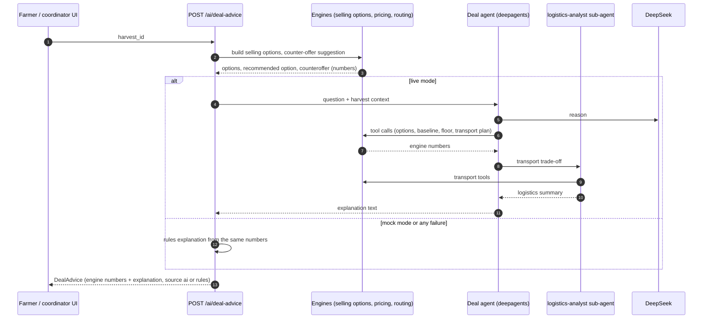

# AI in MandiMate

> **AI for understanding. Rules for decisions. People for trust.**

MandiMate uses language models where language is the problem: a farmer speaking Telugu into a
phone, a trade-off that needs explaining in plain words, a lot proposal a coordinator wants to
understand. It does **not** use them where money, compatibility or feasibility is decided. Those
are deterministic engines documented in [DOMAIN_RULES.md](DOMAIN_RULES.md), and every number an
AI answer mentions was computed by them first.

Code: `backend/app/ai/` (LLM factory, deepagents deal agent, voice parser, prompts, rules-based
mock) behind the service API in `app/ai/service.py`.

## Where AI is used

| Feature | Endpoint | AI contributes | Rules / engines contribute | Without a key |
|---|---|---|---|---|
| **Voice-to-harvest** | `POST /ai/voice-listing` → `VoiceDraft` | Extracts a listing from free speech in English, Hindi, Telugu, Kannada or Urdu, including phrasing the rules do not cover. | Catalogue lookup of the crop, unit conversion, relative dates against today in `Asia/Kolkata`, validation; anything unverified goes to `missing_fields`. | Multilingual rules parser. |
| **Deal negotiation assistant** | `POST /ai/deal-advice` → `DealAdvice` | `explanation`: why the recommended option is better or worse, in plain words, separating confirmed terms from estimates and open conditions. | `options`, `recommended_option_id` and `counteroffer` come from the selling-options and net-proceeds engines. | Deterministic explanation template over the same numbers. |
| **Counter-offer suggestion** | `POST /ai/offers/{id}/counter-suggestion` → `CounterSuggestion` | `rationale` wording. | `suggested_price_per_kg`, `floor_price_per_kg`, `market_reference_per_kg` (DOMAIN_RULES §3, counter-offer suggestion). | Rules rationale. |
| **Smart lot matching** | `POST /ai/match-explanation` → `AiText` | Explains why a proposed group of harvests is a promising match and what information is missing. | Compatibility, scoring and allocation (`services/matching.py`); the explanation never changes the selection. | The engine's own deterministic `explanation`. |
| **Supply & demand summary** | `GET /insights/supply-demand` → `summary: AiText` | A short narrative over the computed balances and forecast. | `by_crop`, `upcoming_supply`, `pilot_metrics`. | Rules summary. |

Every AI response carries `source: "ai" | "rules"`, and free text arrives as `AiText`
(`text`, `source`, `model`, `generated_at`, `disclaimer`). The interface's `AiPanel` shows an
*AI* or *Rules* badge and the disclaimer next to every generated text.

## Where AI is deliberately not used

| Decision | Owner |
|---|---|
| Which harvests are compatible, how many kilograms each contributes | Matching engine (exact grade, radius, dates, shelf life; never exceeds available kg) |
| Prices, costs, deductions, net proceeds, the best option | Net-proceeds engine (`services/pricing.py`, `services/selling_options.py`) |
| Counter-offer floor and suggested price | Rules (linear net function, market reference, rounding up to ₹0.50) |
| Route, vehicle class, transport cost | `services/routing.py` + `estimate_transport_cost` |
| Settlement amounts and payouts | `services/settlement_service.py` from recorded delivery actuals |
| Accepting a deal | The farmer (consent), or a coordinator recording assisted consent, audit-logged |
| Produce grade, weight, freshness, food safety | Physical inspection by a coordinator or the buyer. A photo is supporting evidence only; MandiMate does not grade produce from images. |
| Verification of buyers and transporters, disputes | Coordinators and admins |

If a model's text ever contradicted an engine number, the engine number is what the product
shows, stores and settles on.

## Modes

| `AI_MODE` | Behaviour |
|---|---|
| `auto` (default) | Live when `DEEPSEEK_API_KEY` is set, otherwise mock. |
| `live` | Live; still falls back to rules per request on any failure, and runs as mock when no key is configured. |
| `mock` | Always rules, even with a key. Used by the test-suite and for offline demos. |

The effective mode (`live` or `mock`) is reported by `GET /api/v1/ai/status` (`AiStatus`, with
the model name and enabled features) and by `GET /health` (`ai_mode`). The top bar shows
*AI · Live* or *AI · Demo mode*.

Configuration (`backend/.env`):

| Variable | Default | Meaning |
|---|---|---|
| `AI_MODE` | `auto` | `auto`, `live` or `mock` |
| `DEEPSEEK_API_KEY` | empty | DeepSeek key; empty means demo mode |
| `DEEPSEEK_MODEL` | `deepseek-flash` | Chat model used by every feature |
| `DEEPSEEK_BASE_URL` | `https://api.deepseek.com` | API endpoint (OpenAI-compatible) |
| `AI_TIMEOUT_SECONDS` | `30` | Upper bound for one model call before falling back |

The live model is `langchain_deepseek.ChatDeepSeek`, created in one factory so every feature
shares the same settings, timeout and logging.

## The deal agent (deepagents)

The negotiation assistant is a **deepagents** agent (`create_deep_agent`) built per request for
one harvest and one viewer. Its tools are thin, read-only wrappers over the engines: they return
numbers MandiMate already computed (selling options with every deduction line and its certainty,
the baseline, the counter-offer floor and suggestion, the market reference, transport plans),
already masked for the viewer. The agent cannot write to the database and cannot compute a
number itself.

A **`logistics-analyst` sub-agent** handles transport trade-offs: shared versus solo transport,
vehicle utilisation, how the per-kg transport share changes with lot size, buyer pickup versus
MandiMate delivery. The main agent delegates those questions and folds the answer into one
explanation.



The structured fields of `DealAdvice` are filled from the engines before the agent runs, so a
slow or failed model call never changes what the farmer is offered.

## Voice listing pipeline

```text
 Farmer speaks            Browser                     API                                  Farmer
 ─────────────   ───────────────────────   ─────────────────────────────────────   ─────────────────
 "రేపు ఉదయం      Web Speech API             POST /ai/voice-listing                   Review the draft,
  400 కిలోల       (te-IN · hi-IN · en-IN)   1. rules parser (always)                fill what is
  టమాటాలు          or typed text when the    2. live mode: model extraction,          missing, submit
  సిద్ధం"          browser lacks speech      validated field by field                 POST /harvests
                 recognition               3. VoiceDraft: draft + missing_fields     (listing_source
                                              + follow_up_question + confidence       = "voice")
```

- Speech recognition runs **in the browser** (Web Speech API); MandiMate receives only the
  transcript and the selected language, never audio.
- The rules parser understands digits in every script (ASCII, Devanagari, Telugu, Kannada,
  Arabic-Indic) and number words in all five languages; units (`kg`, `kilo`, `quintal` = 100 kg,
  `tonne` = 1,000 kg, किलो, क्विंटल, కిలో, క్వింటాల్, ಕಿಲೋ/ಕೆಜಿ, ಕ್ವಿಂಟಾಲ್, ಟನ್, کلو, کوئنٹل, ٹن); crop
  names in all five languages (`name`, `name_hi`, `name_te`, `name_kn`, `name_ur` and synonyms);
  relative dates (today, tomorrow, day after; आज, कल, परसों; ఈరోజు, రేపు, ఎల్లుండి; ಇಂದು, ನಾಳೆ,
  ನಾಡಿದ್ದು; آج، کل، پرسوں); and prices such as "₹15 per kilo", "ಕಿಲೋಗೆ 15 ರೂಪಾಯಿ" or
  "15 روپے فی کلو".
- Every field is validated before it reaches the draft: the crop must resolve to a catalogue
  crop, quantities and prices must be positive, dates must parse relative to today in India.
- **Nothing is guessed.** A field the parser or the model could not establish stays `null` and
  is listed in `missing_fields`; `follow_up_question` asks for it in the farmer's language. The
  farmer (or their coordinator) always confirms the draft before anything is listed.

## Fallbacks

- No key or `AI_MODE=mock`: rules only, no network calls at all.
- Live call fails (timeout after `AI_TIMEOUT_SECONDS`, HTTP error, rate limit, malformed
  output, failed validation): the same request is answered by the rules path and labelled
  `source: "rules"`. The user sees an answer, never an AI error.
- The engines never depend on the AI layer, so negotiation, settlement and every number keep
  working if the provider is down.

## Logging: `ai_interactions`

Every AI call, live or rules, is recorded in the `ai_interactions` table: the user who
triggered it, feature, source (`ai` or `rules`), model, latency, input and output size in
characters, success and the error when there was one. **Prompt and response text are never
stored**, only their sizes. That answers the operational questions (how often live calls fall
back, how slow they are, which features people use) and gives a proxy for token spend.
Application logs carry the request id (`X-Request-ID`) so an interaction can be traced end to
end. API keys are never logged.

## Cost control

- **Off by default.** No key, no spend. Development, CI and demos run in mock mode.
- **One small, inexpensive model** (`deepseek-flash`) for every feature, configurable in one
  place.
- **Compact context.** Prompts carry the engine output for one harvest, offer or proposal,
  never whole tables or histories.
- **Bounded calls.** A per-call timeout, and the agent works only through a handful of
  read-only tools, which keeps the number of round trips small.
- **Rules first where they suffice.** The structured answer is always computed without the
  model; the model only adds language.
- **Measured.** `ai_interactions` gives call counts and latency per feature; multiply by the
  provider's token pricing for spend, and switch any deployment to `AI_MODE=mock` instantly.

## Prompt safety

- **User text is data.** Transcripts, notes and names are passed as clearly delimited content,
  never concatenated into instructions, and the system prompts tell the model to ignore
  instructions found inside them.
- **Authoritative numbers come from tools.** The prompts forbid inventing prices, costs,
  quantities or terms and require the model to say when information is unresolved.
- **Least privilege.** Agent tools are read-only and scoped to records the requesting user may
  see; masking rules (farmer names, private minimum prices) are applied before data reaches the
  model.
- **Output is advisory text.** Model output is never executed, never written to business
  tables, and is validated against the response schema; voice drafts are re-validated field by
  field and still require human confirmation.
- **Disclosure.** Every generated text carries a disclaimer and an *AI* / *Rules* badge.

## Testing without the network

- The test-suite forces `AI_MODE=mock` and never calls DeepSeek or any other external service;
  running the tests needs no key and no internet connection.
- Rules paths (voice parser, explanations, counter-offer rationale) are tested with fixed
  inputs across all five languages (English, Hindi, Telugu, Kannada, Urdu).
- Live code paths (agent wiring, tool calls, sub-agent delegation, fallbacks) are exercised with
  LangChain fake chat models that return scripted messages, so behaviour such as
  "malformed model output falls back to rules" is tested deterministically.
- See [TESTING.md](TESTING.md) for the full test strategy.
